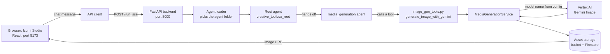

# Flow map: how Izumi works today, and where the reviewer could fit

Status: DRAFT for Dewi to review. Paths checked against upstream commit `e5f12b0` (the base of the `dewi-sprint` branch). The "where the reviewer could fit" part is a proposal, not a decision.

## Today: one request, end to end (creative_toolbox agent)

In words:
1. You type in the chat in the browser.
2. The frontend sends it to the backend (`/run_sse`, a streaming call) and also reads and writes chat sessions (`/apps/<agent>/users/<project>/sessions`).
3. The backend finds the agent you picked and runs it. The root agent decides what to do and hands image requests to the `media_generation` agent.
4. That agent calls a tool, which calls the shared service, which calls the Vertex AI model named in the config.
5. The image is saved as an asset (storage bucket, with records in Firestore). The browser shows it through `/workspaces/<project>/assets/<id>/view`.

## Where things live

| Piece | File or folder |
| --- | --- |
| Chat screen | `demos/frontend/src/components/project-view/chat/ChatInterface.tsx`, `ActiveConversation.tsx` |
| Pick an agent, descriptions shown to the user | `demos/frontend/src/data/agents.ts` |
| Frontend calls to the backend | `demos/frontend/src/services/api/client.ts` (base URL), `chat.ts` (chat and sessions), `assets.ts`, `media.ts` |
| Image upload in the UI | `demos/frontend/src/components/shared/ImageUpload.tsx` |
| Backend start-up and agent discovery | `demos/backend/main.py` (every agent folder under `demos/backend/` is listed) |
| The four agents | `demos/backend/ads_codirector/`, `ads_x/`, `creative_toolbox/`, `elements_to_video/` (each has `agent.py`) |
| Agent instructions (the prompts) | `demos/backend/creative_toolbox/instructions/` (`root.py`, `media_generation.py`, ...) |
| Agent tools | `demos/backend/creative_toolbox/tools/` (`image_gen_tools.py`, `gemini_llm_tools.py`, `asset_tools.py`, ...) |
| Shared service that calls the models | `mediagent_kit/services/media_generation_service.py` |
| Which model is used for which task | `mediagent_config.json` (text, image_imagen, image_gemini, video, music, tts) and `mediagent_kit/config.py` (loads it) |
| Project, bucket, region settings | `demos/backend/.env.local` (private, not committed), `demos/backend/config.py` |

## What I changed on Day 1, on this map

- `demos/backend/creative_toolbox/agent.py`: the root agent's model name (retired model).
- `demos/backend/creative_toolbox/tools/image_gen_tools.py`: empty reference-image names are dropped before the service looks them up.
- `.env.local`: region set to `global`.

## Things worth knowing (verified in the code)

- `creative_toolbox` has its own hard-coded model names. `mediagent_config.json` does not control the agent's own model, only the tool calls that read it.
- `ads_codirector`, `elements_to_video`, and one tool in `creative_toolbox` (`gemini_llm_tools.py`) still use `gemini-2.5-flash` in code. `ads_x` already uses `gemini-3.7-flash`.
- `gemini_llm_tools.py` already sends image files to Gemini together with text (it builds image parts), so "look at images and answer in text" is something the code already does.
- `ads_x` already has a human review step: a card in the chat (`GateReviewCard.tsx`) fed by `ads_x/tools/storyboard/gate_tools.py`. It is the closest existing pattern to Keep / Reject / Need more information.

## Where the reviewer could fit (proposal, to decide)

| Question | Option A (smallest) | Option B |
| --- | --- | --- |
| Where does the review logic live? | A new tool in `creative_toolbox/tools/` that sends both images and the criteria to Gemini, added to the agent's tool list | A new agent folder under `demos/backend/` (it is picked up automatically) |
| How does it appear to Lena? | Chat reply with findings per criterion | Same, plus an entry in `agents.ts` |
| Where is the human decision recorded? | A simple Keep / Reject / Need more information choice stored separately from the AI result | Reuse the idea of `GateReviewCard` |

Suggested for the sprint: Option A first (fewest files to touch), then add the decision control.

## To sketch yourself

Draw four boxes: Browser, Backend, Agents, Models and storage. Mark where an image goes in (upload), where the review happens (new), and where Lena decides (new).
